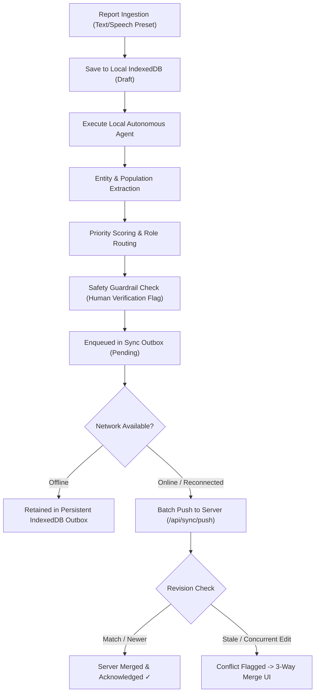

# FieldPilot — OfflineFirst AI Autonomous Agent Platform

> **"Internet availability must not determine whether a field worker can create, store, and complete critical local tasks."**

[](https://www.python.org/)
[](https://fastapi.tiangolo.com/)
[](https://react.dev/)
[](https://dexie.org/)
[](https://web.dev/progressive-web-apps/)
[](LICENSE)

---

## 1. Problem Statement & Mission

In rural areas, disaster zones, and agricultural frontiers, field workers, village administrators, and NGO teams face intermittent or non-existent cellular connectivity. Traditional cloud-dependent AI systems fail completely when the network drops.

**FieldPilot** is an open-source, offline-first autonomous agent platform engineered to:
1. Run lightweight, grounded AI models locally on the device with zero cloud connectivity or API keys required.
2. Complete queued tasks offline with deterministic heuristics, entity extraction, and structured civic action generation.
3. Manage limited hardware resources (device battery consumption, low-power throttling, and IndexedDB storage quotas).
4. Persist all tasks in IndexedDB and an offline sync outbox queue.
5. Reliably synchronize verified results when network connectivity returns using revision tracking and 3-way conflict resolution.
6. Enforce strict safety guardrails: **The agent is strictly forbidden from claiming that a repair has occurred without verified evidence.**

---

## 2. End-to-End Core Workflow



---

## 3. Technology Stack

### Frontend & Offline Runtime
- **Framework**: React 19 + TypeScript + Vite
- **Styling**: Tailwind CSS v4 + Glassmorphism design system + Lucide icons
- **Client Persistence**: Dexie.js (IndexedDB wrapper) with reactive `useLiveQuery`
- **Offline Capabilities**: Progressive Web App (PWA) manifest & Service Worker shell caching
- **Hardware Telemetry**: Battery Status API & Storage Estimation API integration with interactive testing slider
- **Network Simulator**: In-app toggling between **Online**, **Flaky 2G (High Latency)**, and **Deep Offline**

### Backend & API
- **Framework**: Python 3.11+ / 3.13 with FastAPI
- **Database**: SQLite with SQLAlchemy 2.0 ORM (`fieldpilot.db`)
- **Validation**: Pydantic v2 schemas with timezone-aware datetime serialization
- **Synchronization**: Batch push/pull protocol with idempotency keys and server revision tracking
- **Testing**: Automated backend test suite running under `pytest`

### Agent Runtime
- **Deterministic Heuristic Engine**: On-device, zero-dependency, ultra-fast rule-based NLP agent optimized for rural infrastructure, public health, agriculture, and civic utilities.
- **Pluggable LocalModelProvider Interface**: Pluggable interface supporting local LLM inference engines like **Ollama** (`http://localhost:11434`) and **llama.cpp** (`http://localhost:8080`).

---

## 4. Default Benchmark Demonstration: Village Hand Pump Breakdown

The platform includes a built-in verified benchmark test case representing a real-world rural failure:

> **Report:** *"The hand pump near the village primary school has stopped working. Around 40 families depend on it."*

When executed by FieldPilot:
1. **Domain Classification**: Categorized as `water_supply` (Confidence: 94%).
2. **Entity & Impact Extraction**:
   - Detected Location: `Near Village Primary School, Sector 2`
   - Estimated Affected Population: `40 families (~200 villagers)`
3. **Deterministic Priority Scoring**: Evaluated as `CRITICAL` due to primary school proximity and high dependent household count.
4. **Actionable Civic Directives**:
   - *Directive 1*: Dispatch Block Water Supply Mechanical Team to inspect cylinder, chain, and riser pipe.
   - *Directive 2*: Coordinate emergency 3,000L Potable Water Tanker delivery for the primary school and 40 families.
   - *Directive 3*: Water Quality & Borewell Static Level test by Field Health Inspector.
5. **Safety Guardrail**: `verified_evidence: false` and `needs_human_verification: true`. The system enforces that no task can be marked as "Repaired" without verified physical on-site evidence.
6. **Replication**: Stored locally in IndexedDB; queued into outbox; automatically synced to SQLite server upon connection.

---

## 5. Quick Start & Setup Instructions

### Prerequisites
- Node.js (v18+) and npm
- Python (3.11+)

### 1. Clone & Setup Backend
```bash
# Navigate to backend directory
cd backend

# Create and activate virtual environment
python -m venv .venv

# Windows:
.venv\Scripts\activate
# Linux/macOS:
# source .venv/bin/activate

# Install dependencies
pip install -r requirements.txt

# Run automated tests
pytest tests

# Launch backend API server (runs at http://127.0.0.1:8000)
python run_backend.py
```

### 2. Setup & Launch Frontend
```bash
# In a separate terminal, navigate to frontend directory
cd frontend

# Install npm dependencies
npm install

# Verify production build
npm run build

# Start Vite development server (runs at http://127.0.0.1:5173)
npm run dev
```

Open `http://127.0.0.1:5173` in your browser.

---

## 6. Application Routes

| Route | View | Description |
|---|---|---|
| `#/dashboard` | **Overview Dashboard** | KPI metrics, battery/hardware governance widget, benchmark demo runner, recent tasks. |
| `#/tasks` | **Tasks & Incidents List** | Filterable by Category (Water, Agriculture, Healthcare, Infrastructure, Education), Status, and Priority. |
| `#/new` | **New Field Report** | Incident form with 4 quick-fill benchmark presets and instant local agent execution. |
| `#/sync` | **Sync Hub & Outbox** | Persistent outbox queue, network simulator controls (Online / 2G / Offline), and 3-way conflict resolver. |
| `#/agent` | **Agent Studio & Hardware** | Model provider selector (Deterministic vs Ollama), battery saver threshold slider, and raw agent sandbox. |

---

## 7. Hardware Resource Governance

Field devices operating in rural zones suffer from rapid battery drain and limited storage:
- **Low Power Throttling Mode**: When battery falls below the configured threshold (default 20%) and the device is not plugged in, heavy background queue execution is deferred to preserve battery for critical communications.
- **Storage Quota Management**: Storage is bounded using IndexedDB with automatic audit log pruning and telemetry tracking.
- **Energy Metric**: The deterministic engine executes in ~35ms with an estimated energy footprint of only ~0.04 mWh per task.

---

---

## 8. Smart Task Priority Assistant & Smart Offline Sync Monitor

### Feature 1: Smart Task Priority Assistant
The Smart Task Priority Assistant is an autonomous, transparent, 100% offline rule engine ([frontend/src/services/priorityAssistant.ts](file:///c:/Users/madha/Downloads/Nithin/frontend/src/services/priorityAssistant.ts)) that dynamically evaluates field incidents without requiring cloud AI APIs or internet access.

- **Deterministic Urgency Scoring (0–100 Scale)**:
  - **Critical Keywords (+25 to +40 pts)**: Detects immediate hazards such as `contamination`, `epidemic`, `outbreak`, `collapse`, `failure`, `broken`, `hazard`, and `flood`.
  - **Sensitive Infrastructure (+20 pts)**: Recognizes institutions like `school`, `hospital`, `clinic`, `ward`, and `daycare`.
  - **Domain Base Weights (+15 to +30 pts)**: `healthcare` (+30), `water_supply` (+25), `infrastructure` (+20), `agriculture` (+15).
  - **Population Density Scaling (+10 to +25 pts)**: Scales dynamically based on affected headcounts extracted from incident reports.
  - **Routine Incident Deduction (-25 pts)**: De-escalates routine maintenance keywords like `routine`, `inspection`, `annual`, `scheduled`, `minor cosmetic`.
- **Classification Output**:
  - `HIGH` (Score $\ge 70$): Immediate intervention required; critical safety hazards or vulnerable populations affected.
  - `MEDIUM` (Score $35–69$): Scheduled intervention required; moderate disruption or non-acute public impact.
  - `LOW` (Score $< 35$): Deferrable or routine task; maintenance inspection or cosmetic issues.
- **Transparent Explanations & Next Action Directives**:
  - Provides a human-readable **Contextual Reason** (e.g., *"High-impact civic issue affecting school/clinic infrastructure or 50+ residents; requires swift dispatch."*).
  - Generates a **Practical Suggested Next Action** (e.g., *"Deploy emergency repair technician and allocate potable water relief within 6 hours."*).
  - Displays a detailed **Factors Breakdown** in the task modal for operational transparency.
- **Full Backward & Forward Compatibility**:
  - Automatically maps legacy database priorities (`critical`, `high`, `medium`, `low`) to and from assistant priority levels (`HIGH`, `MEDIUM`, `LOW`).
  - Filterable on the **Tasks Page** dropdown with instant live updates.

---

### Feature 2: Smart Offline Sync Monitor
The Smart Offline Sync Monitor ([frontend/src/components/SmartSyncMonitor.tsx](file:///c:/Users/madha/Downloads/Nithin/frontend/src/components/SmartSyncMonitor.tsx)) provides real-time operational visibility into data persistence, network status, and replication synchronization.

- **Dual-Layer Connectivity Detection**:
  - **Browser Interface**: Listens to native `online`/`offline` window events.
  - **Backend Reachability Probe**: Periodically pings `/api/health` with a 3-second timeout to differentiate between active internet connection and actual backend API accessibility (e.g. captive portals or server downtime).
  - **Latency Measurement**: Displays round-trip server response time in milliseconds.
- **Real Application Metric Counters (Powered by IndexedDB/Dexie)**:
  - **Pending**: Local mutations waiting in the persistent outbox queue.
  - **Syncing**: Operations currently being transmitted to the server.
  - **Synced**: Tasks successfully acknowledged and committed by the backend.
  - **Failed**: Operations that exceeded retry thresholds or encountered non-recoverable errors.
  - **Conflicts**: Incidents where concurrent edits require 3-way conflict resolution.
- **Persistent Outbox Queue Inspector**:
  - Outbox records survive browser refreshes and system restarts in IndexedDB.
  - Collapsible drawer reveals operation type (`create_task`, `update_task`), entity ID, retry attempts, last error message, and formatted payload preview.
- **Resilient Retry & Exponential Backoff Policy**:
  - Calculates backoff delay dynamically: $\text{delay} = \min(30000, 1000 \times 2^{\text{retries}})$.
  - Max retry cap: 5 attempts before marking as `failed`.
- **Manual Actions & Concurrency Mutex**:
  - **Sync Now**: Triggers immediate outbox flush with concurrency lock to avoid duplicate server submissions.
  - **Retry Failed**: Resets retry counters on failed operations and automatically attempts resynchronization.

---

## 9. Verification & Automated Test Results

- **Frontend Unit Test Suite (`npm test`)**:
  - 46 unit tests executed via Node.js native test runner in [src/test/priorityAndSync.test.ts](file:///c:/Users/madha/Downloads/Nithin/frontend/src/test/priorityAndSync.test.ts).
  - **Result**: `46 pass, 0 fail` (100% passing across priority classification, rule weights, legacy mapping, bounded exponential backoff, and outbox idempotency).
- **Frontend Production Build (`npm run build`)**:
  - Executed `tsc -b && vite build`.
  - **Result**: Successfully compiled in 359ms with zero errors.
- **Backend Automated Pytest Suite (`pytest tests`)**:
  - 11 automated API, sync, and conflict resolution tests executed via `.venv\Scripts\python -m pytest backend/tests`.
  - **Result**: `11 passed` in 1.20s.
- **PWA & Cache Verification**:
  - High-resolution icons (`icon-192.png`, `icon-512.png`), SVG favicons, Web App Manifest (`manifest.json`), and Service Worker (`sw.js` v3) configured with same-origin selective caching.

---

## 10. License

Open source under the [MIT License](LICENSE). Built for rural resilience and offline-first autonomous AI systems.
